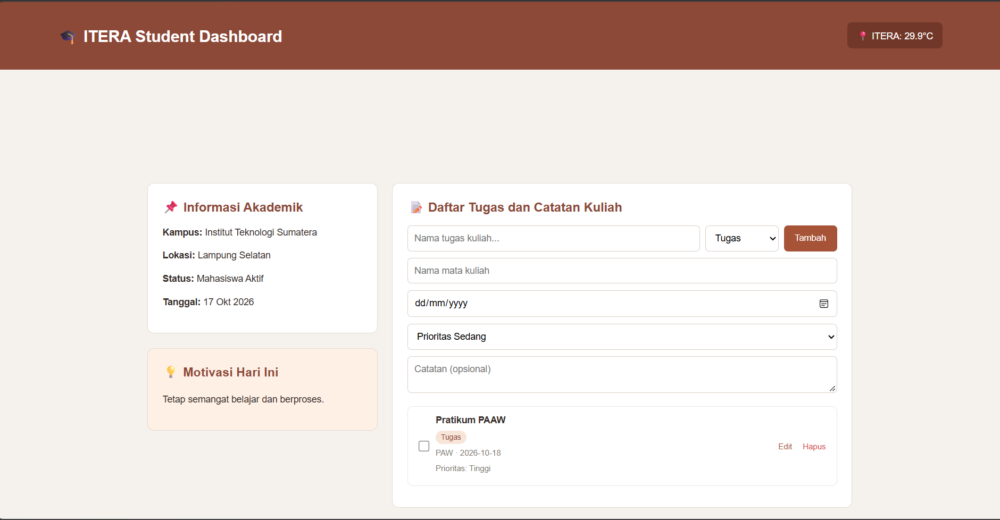

# ITERA Student Dashboard

## Deskripsi
ITERA Student Dashboard adalah aplikasi web sederhana untuk membantu mahasiswa melihat informasi akademik, motivasi belajar, informasi cuaca, serta mengelola daftar tugas dan catatan kuliah dalam satu halaman.

## Fitur
- Menampilkan informasi akademik mahasiswa.
- Menampilkan motivasi belajar.
- Menampilkan informasi cuaca ITERA.
- Menambahkan tugas atau catatan kuliah.
- Menentukan mata kuliah, tanggal, prioritas, dan catatan.
- Menandai tugas yang sudah selesai.
- Mengedit dan menghapus tugas.
- Menyimpan data tugas menggunakan Local Storage, jika diterapkan pada kode aplikasi.

## Teknologi
- **HTML** untuk struktur halaman.
- **CSS** untuk tampilan dan tata letak.
- **JavaScript** untuk interaksi dan pengelolaan tugas.
- **Weather API** untuk informasi cuaca, jika API digunakan dalam kode.

## Konsep JavaScript ES6+
Proyek ini dapat menggunakan konsep JavaScript modern berikut sesuai implementasi pada file `script.js`:
- `class` untuk mengelompokkan fungsi dan data aplikasi.
- Arrow function untuk menulis fungsi secara ringkas.
- Template literals untuk menyusun teks atau HTML.
- `async/await` untuk menangani permintaan data secara asynchronous.
- Local Storage untuk menyimpan data pada browser.

## Cara Menjalankan
1. Simpan semua file proyek dalam satu folder.
2. Pastikan `index.html`, `style.css`, dan `script.js` berada pada folder yang sama.
3. Buka folder proyek menggunakan Visual Studio Code.
4. Jalankan `index.html` dengan ekstensi Live Server, atau buka langsung file tersebut melalui browser.
5. Jika dashboard mengambil data cuaca dari API, pastikan perangkat terhubung ke internet.

## Screenshot
Berikut tampilan ITERA Student Dashboard.



## Struktur Folder
```text
Personal-Dashboard/
├──image
|   └── 1.png
├── index.html
├── style.css
├── script.js
└──  README.md

```

## Identitas Pengembang
- **Nama:** Fauzan Habib Pratama
- **NIM:** 124140017
- **Tugas:** Praktikum Paw2
