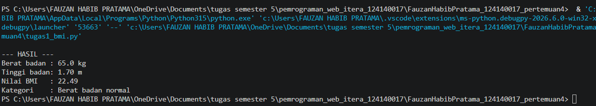
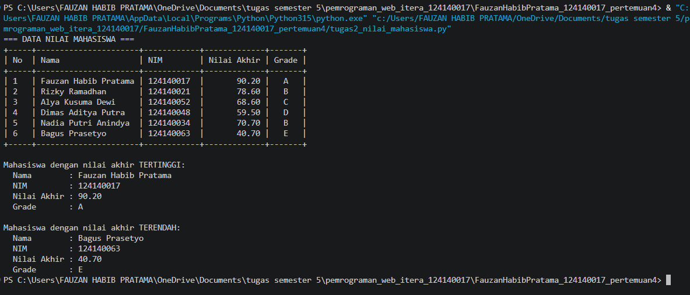
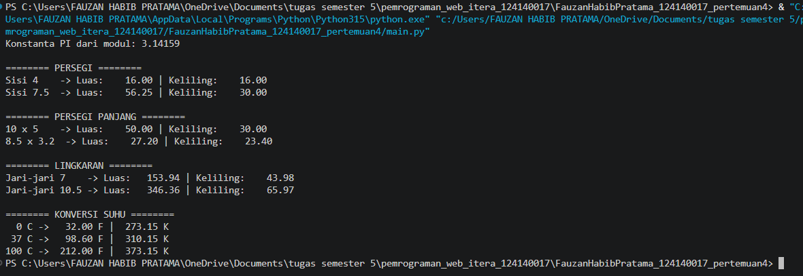

# Praktikum Pengembangan Aplikasi Web - Pertemuan 4 (Python Dasar)

## Identitas

- **Nama:** Fauzan Habib Pratama
- **NIM:** 124140017
- **Program Studi:** Teknik Informatika

## Tentang Tugas Ini

Tugas pertemuan 4 berisi tiga program Python yang melatih dasar-dasar bahasa ini: input dan output, percabangan, list dan dictionary, fungsi, sampai pembuatan modul sendiri. Di bawah ini penjelasan alur kerja dan fungsi yang ada di tiap program.

### Soal 1 - Kalkulator BMI (`tugas1_bmi.py`)

Program ini menghitung Body Mass Index dari berat dan tinggi badan yang diketik pengguna.

**Alur kerja:**
1. Pengguna mengisi berat badan dalam kg, lalu tinggi badan dalam meter.
2. Program mengecek input. Kalau bukan angka atau nilainya nol dan negatif, muncul pesan kesalahan dan program berhenti.
3. BMI dihitung dengan rumus `berat / (tinggi * tinggi)`.
4. Hasil dimasukkan ke kategori lewat percabangan `if-elif-else`.
5. Berat, tinggi, nilai BMI (dua angka desimal lewat f-string), dan kategori ditampilkan.

**Kategori BMI:**

| Rentang BMI | Kategori |
|---|---|
| kurang dari 18.5 | Berat badan kurang |
| 18.5 sampai kurang dari 25 | Berat badan normal |
| 25 sampai kurang dari 30 | Berat badan berlebih |
| 30 atau lebih | Obesitas |

**Fungsi:**
- `hitung_bmi(berat, tinggi)` menghitung dan mengembalikan nilai BMI.
- `tentukan_kategori(bmi)` mengembalikan teks kategori sesuai tabel di atas.
- `main()` mengatur urutan input, validasi, perhitungan, dan pencetakan hasil.

### Soal 2 - Pengelolaan Nilai Mahasiswa (`tugas2_nilai_mahasiswa.py`)

Program ini mengolah nilai enam mahasiswa dan menampilkannya dalam bentuk tabel.

**Alur kerja:**
1. Data disimpan dalam sebuah list yang berisi dictionary. Tiap dictionary punya kunci `nama`, `nim`, `nilai_uts`, `nilai_uas`, dan `nilai_tugas`.
2. Nilai akhir dihitung dengan bobot 30% UTS, 40% UAS, dan 30% tugas.
3. Grade ditentukan dari nilai akhir: A (80 ke atas), B (70-79), C (60-69), D (50-59), dan E (di bawah 50).
4. Semua data ditampilkan dalam tabel berisi nomor, nama, NIM, nilai akhir, dan grade, dirapikan dengan perataan f-string.
5. Program mencari mahasiswa dengan nilai akhir paling tinggi dan paling rendah, lalu menampilkan datanya.

**Fungsi:**
- `hitung_nilai_akhir(uts, uas, tugas)` menghitung nilai akhir berdasarkan bobot.
- `tentukan_grade(nilai_akhir)` mengembalikan grade huruf.
- `proses_data(daftar)` menambahkan nilai akhir dan grade ke setiap data mahasiswa.
- `tampilkan_tabel(daftar)` mencetak tabel data mahasiswa.
- `tampilkan_info(judul, mhs)` mencetak rincian satu mahasiswa.
- `main()` menjalankan seluruh proses, termasuk mencari nilai tertinggi dan terendah dengan `max()` dan `min()`.

Catatan: nama dan nilai mahasiswa selain namaku adalah data karangan untuk keperluan uji program.

### Soal 3 - Modul Matematika (`math_operations.py` dan `main.py`)

Soal ini dikerjakan dengan dua file. `math_operations.py` berperan sebagai modul berisi kumpulan fungsi, sedangkan `main.py` adalah program yang memakainya.

**Isi `math_operations.py`:**
- Konstanta `PI` bernilai 3.14159.
- Persegi: `luas_persegi(sisi)` dan `keliling_persegi(sisi)`.
- Persegi panjang: `luas_persegi_panjang(panjang, lebar)` dan `keliling_persegi_panjang(panjang, lebar)`.
- Lingkaran: `luas_lingkaran(jari_jari)` dan `keliling_lingkaran(jari_jari)`.
- Konversi suhu: `celsius_ke_fahrenheit(celsius)` dan `celsius_ke_kelvin(celsius)`.

**Alur `main.py`:**
1. Modul diimpor dengan tiga gaya: `import math_operations`, `from math_operations import ...`, dan `import math_operations as mo`.
2. Seluruh fungsi modul dipanggil dengan beberapa nilai percobaan.
3. Hasil dicetak per bagian: persegi, persegi panjang, lingkaran, dan konversi suhu. Fungsi `garis(judul)` dipakai untuk judul tiap bagian, sedangkan `main()` mengatur urutannya.

`math_operations.py` tidak perlu dijalankan sendiri karena otomatis terpakai ketika `main.py` dijalankan.

## Cara Menjalankan

**Yang dibutuhkan:** Python 3.10 atau lebih baru dan Visual Studio Code.

1. Buka folder `FauzanHabibPratama_124140017_pertemuan4` di VS Code lewat **File → Open Folder...**
2. Buka terminal bawaan VS Code dengan `Ctrl` + `` ` ``.
3. Jalankan program satu per satu:

```bash
python tugas1_bmi.py
python tugas2_nilai_mahasiswa.py
python main.py
```

Kalau `python` tidak dikenali di Windows, coba `py` atau `python3`.

Program soal 1 akan meminta input. Untuk percobaanku, aku memakai berat `65` kg dan tinggi `1.70` m. Program soal 2 dan 3 langsung menampilkan hasil tanpa input.

## Bukti Hasil Eksekusi

### Soal 1 - Kalkulator BMI
Input berat 65 kg dan tinggi 1.70 m menghasilkan BMI 22.49 dengan kategori berat badan normal.



### Soal 2 - Pengelolaan Nilai Mahasiswa
Tabel enam mahasiswa lengkap dengan nilai akhir dan grade. Nilai tertinggi dipegang Fauzan Habib Pratama (90.20, grade A) dan yang terendah Bagus Prasetyo (40.70, grade E).



### Soal 3 - Modul Matematika
Hasil luas dan keliling persegi, persegi panjang, lingkaran, serta konversi suhu dari Celsius ke Fahrenheit dan Kelvin.



## Struktur Folder

```text
FauzanHabibPratama_124140017_pertemuan4/
├── .gitignore
├── README.md
├── tugas1_bmi.py
├── tugas2_nilai_mahasiswa.py
├── math_operations.py
├── main.py
└── image/
    ├── soal1.png
    ├── soal2.png
    └── soal3.png
```

## Penutup

Ketiga program sudah berjalan sesuai yang diminta. Lewat tugas ini aku jadi lebih paham cara memakai percabangan, menyimpan data dalam list dan dictionary, memecah logika ke dalam fungsi, serta memisahkan kode ke dalam modul supaya lebih rapi dan bisa dipakai ulang.