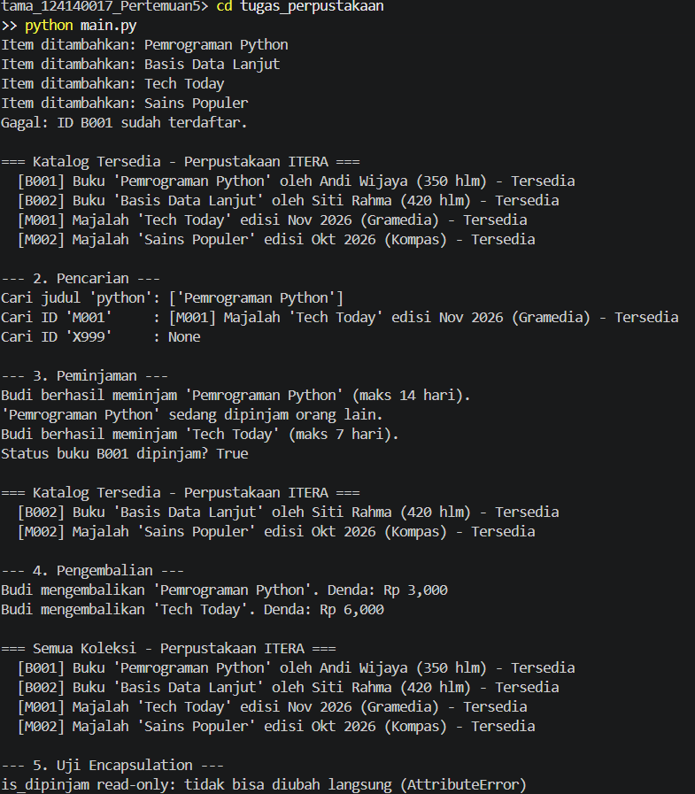

# Tugas Praktikum Pertemuan 5: Sistem Manajemen Perpustakaan

## 1. Identitas Mahasiswa
- **Nama Lengkap**    : Fauzan Habib Pratama
- **NIM**             : 124140017
- **Kelas Praktikum** : RB

## 2. Deskripsi Program
Program ini adalah sistem manajemen perpustakaan sederhana berbasis OOP Python.

**Alur program:**
1. `main.py` membuat objek `Library`, lalu menambahkan beberapa `Book` dan `Magazine`.
2. Program menampilkan katalog item yang tersedia.
3. Program mencari item berdasarkan judul atau ID.
4. Objek `Member` meminjam dan mengembalikan item, termasuk perhitungan denda keterlambatan.

**Penerapan 4 pilar OOP:**
- **Class & Object**: `LibraryItem`, `Book`, `Magazine`, `Member`, dan `Library` dibuat sebagai class, lalu diinstansiasi menjadi objek di `main.py`.
- **Inheritance**: `Book` dan `Magazine` mewarisi abstract class `LibraryItem` dan memanggil `super().__init__()`. Keduanya wajib mengimplementasikan abstract method `get_detail()`, `hitung_denda()`, dan `durasi_pinjam()`.
- **Encapsulation**: Atribut `__dipinjam` (private) pada `LibraryItem`, `__koleksi` (private) pada `Library`, dan `__daftar_pinjam` (private) pada `Member` tidak bisa diubah langsung dari luar class. Atribut `_item_id` dan `_judul` bersifat protected. Data dibaca lewat `@property` (`item_id`, `judul`, `is_dipinjam`, `jumlah_pinjaman`).
- **Polymorphism**: `get_detail()`, `hitung_denda()`, dan `durasi_pinjam()` dipanggil dengan cara yang sama pada semua `LibraryItem`, tetapi hasilnya berbeda. Denda `Book` Rp 1.000/hari dan `Magazine` Rp 2.000/hari.

## 3. Panduan Menjalankan Program
```bash
cd tugas_perpustakaan
python main.py
```

## 4. Screenshot Output
Screenshot di bawah menunjukkan fitur penambahan item, pencarian, dan penampilan katalog.


